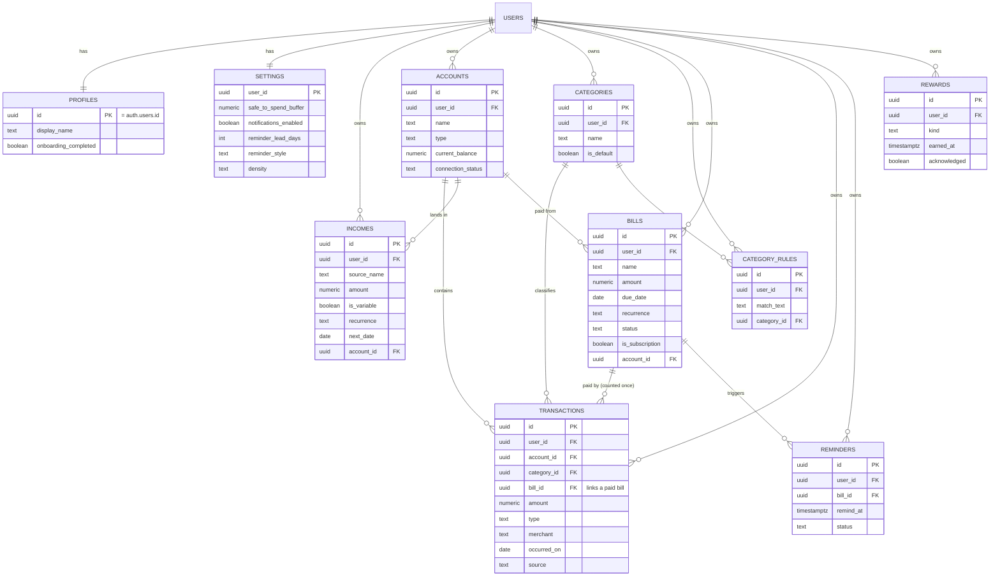

# Database Diagram — ADHD Budgeting App (MVP #1)

Entity-relationship diagram of the Supabase schema. GitHub renders the Mermaid
block below as a picture. Cross-checked against Supabase's Schema Visualizer.

Every table is owned by a Supabase auth user and protected by owner-only Row
Level Security. `USERS` is Supabase's built-in `auth.users`.

## How money is counted once
A paid bill is recorded as a `TRANSACTIONS` row with its `bill_id` set, so
safe-to-spend subtracts only **unpaid** upcoming bills and never double-counts.
Expected future income comes from `INCOMES`; once received it becomes a
`TRANSACTIONS` row of type `income`.
